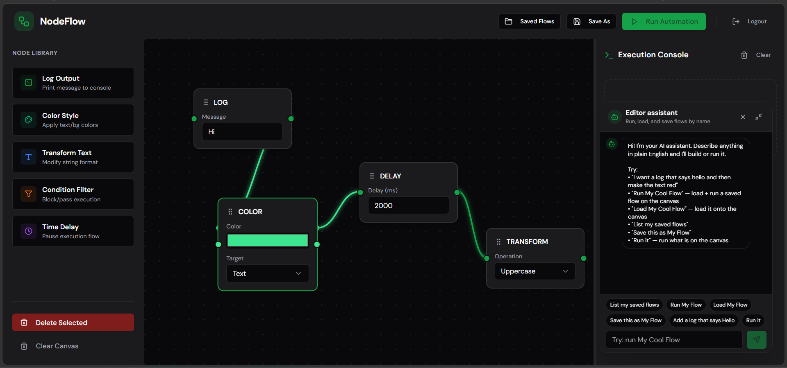
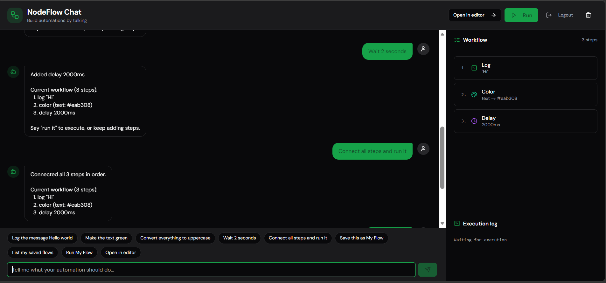
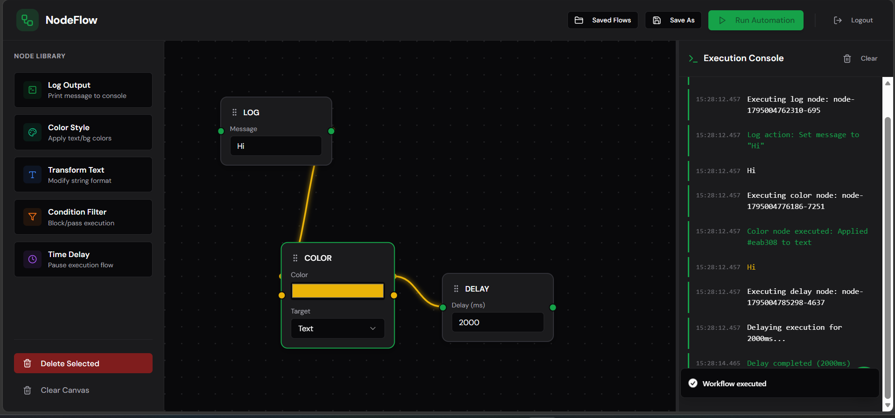
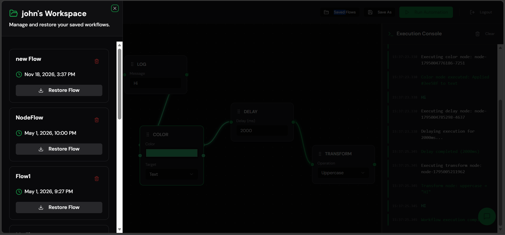

# NodeFlow

NodeFlow is a full-stack visual workflow builder. Create automation flows by connecting configurable nodes in a visual editor, or describe a flow in plain English and let the chat assistant build it for you.

## Features

- **Visual workflow editor** — add, configure, connect, move, and remove nodes on a canvas.
- **Chat-based workflow building** — describe the steps you want in plain English, then review or edit the generated workflow.
- **Built-in node types** — log output, color, text transformation, filtering, and delay.
- **Workflow execution** — run flows in the browser and inspect execution logs.
- **Accounts and saved workflows** — register and sign in to save, load, update, and delete workflows.
- **SQLite storage** — user accounts and saved workflows are stored locally in SQLite.

## Tech stack

- **Frontend:** React 18, Vite, Tailwind CSS, shadcn/ui, Framer Motion
- **Backend:** Node.js, Express
- **Database:** SQLite with `better-sqlite3`
- **Authentication:** JWT and `bcryptjs`
- **AI:** Groq or an OpenAI-compatible API

## Project structure

```text
apps/
├── api/
│   ├── data/                 # Local SQLite database (created at runtime)
│   └── src/
│       ├── chat/             # AI workflow assistant and message parser
│       ├── routes/           # Chat, account, and workflow API routes
│       ├── db.js             # SQLite setup
│       └── server.js         # Express API server
└── web/
    └── src/
        ├── components/       # Editor, chat, and shared UI components
        ├── hooks/            # Workflow and UI hooks
        ├── lib/              # Workflow execution engine and API client
        └── pages/            # Home, editor, and chat pages
```

## Requirements

- Node.js 20.19+ (or 22.12+)
- npm
- An API key for Groq or OpenAI to enable the AI workflow assistant

## Run locally

Clone the repository and install dependencies from the project root:

```bash
git clone https://github.com/YOUR_USERNAME/YOUR_REPOSITORY.git
cd YOUR_REPOSITORY
npm install
```

Create `apps/api/.env` and add your AI provider key and a private JWT secret:

```env
GROQ_API_KEY=your_groq_api_key
JWT_SECRET=replace_with_a_long_random_secret
```

Alternatively, configure `OPENAI_API_KEY` instead of `GROQ_API_KEY`. If multiple providers are configured, Groq is selected first.

Start both servers from the project root:

```bash
npm run dev
```

Open the app at [http://localhost:5000](http://localhost:5000).

| Service | Local address |
|---------|---------------|
| Web app | `http://localhost:5000` |
| API | `http://localhost:3001` |

The SQLite database is created automatically at `apps/api/data/app.db`.

## Available scripts

| Command | Description |
|---------|-------------|
| `npm run dev` | Start the API and web development servers |
| `npm run dev:api` | Start the API server only |
| `npm run dev:web` | Start the web development server only |
| `npm run build` | Build the web app |
| `npm run start` | Start the API and preview the built web app |
| `npm run lint` | Run the web app linter |

## Pages

- `/` — NodeFlow landing page
- `/nodeflow` — visual workflow editor
- `/chat` — chat-based workflow builder

## API endpoints

| Method | Endpoint | Description |
|--------|----------|-------------|
| `GET` | `/api/health` | API health check |
| `POST` | `/api/chat` | Send a message to the workflow assistant |
| `POST` | `/api/collections/users/records` | Register an account |
| `POST` | `/api/collections/users/auth-with-password` | Sign in |
| `GET` | `/api/collections/users/auth-refresh` | Refresh the signed-in session |
| `GET` | `/api/collections/workflows/records` | List saved workflows |
| `POST` | `/api/collections/workflows/records` | Save a workflow |
| `GET` | `/api/collections/workflows/records/:id` | Get a saved workflow |
| `PATCH` | `/api/collections/workflows/records/:id` | Update a saved workflow |
| `DELETE` | `/api/collections/workflows/records/:id` | Delete a saved workflow |

Workflow endpoints require a valid signed-in session.

## Screenshots

### Visual Workflow Editor


### AI-Powered Workflow Generation


### Workflow Execution


### Saved Workflows

